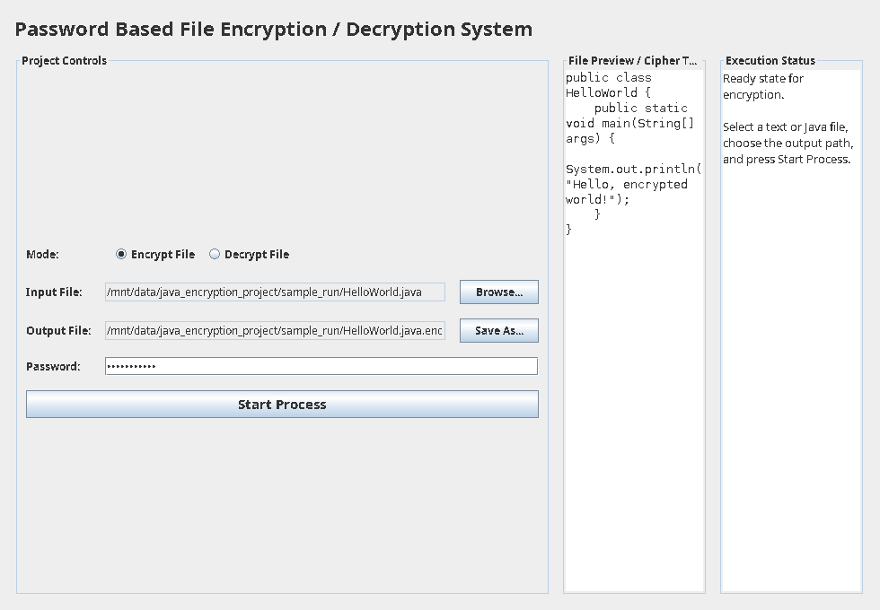
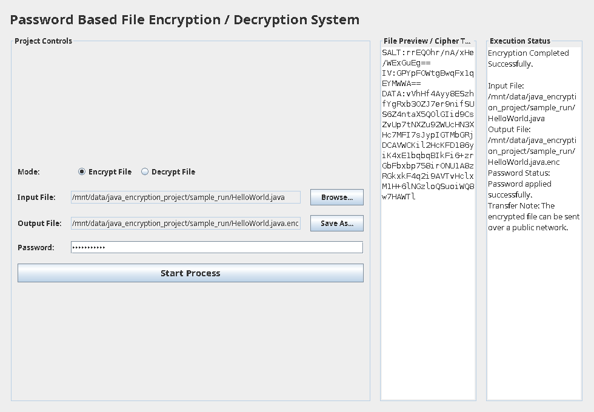
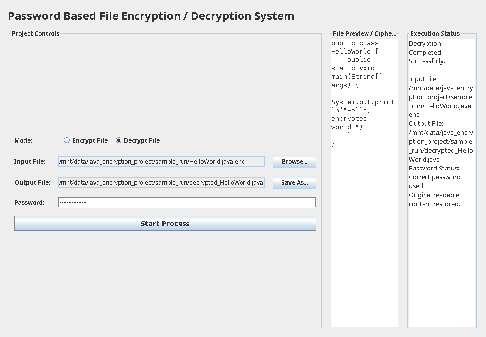

# Text File Encryption Decryption Project in Java

**Name:** USMAN ALI
**Class:** BSSE 5A
**Roll Number:** 302-241025
**Email:** usmanali1832005@gmail.com

## Project Files Included

1. `src/encryptionapp/CryptoUtils.java`
2. `src/encryptionapp/FileEncryptionApp.java`
3. `src/encryptionapp/ScreenshotGenerator.java`
4. `screenshots/` - generated screen outputs
5. `sample_run/` - sample input, encrypted output, and decrypted output

## What This Project Does

- Select a .txt or .java file using a GUI.
- Enter a password.
- Encrypt the file into unreadable cipher text.
- Save the encrypted file to disk.
- Decrypt the cipher text back into the original file using the same password.

## How to Compile

From the project root folder, run:

**Windows:**

```
javac -d out src\encryptionapp\*.java
```

**Linux / macOS:**

```
javac -d out src/encryptionapp/*.java
```

## How to Run

**Windows:**

```
java -cp out encryptionapp.FileEncryptionApp
```

**Linux / macOS:**

```
java -cp out encryptionapp.FileEncryptionApp
```

## How to Generate Screenshots Again

**Windows:**

```
java -cp out encryptionapp.ScreenshotGenerator .
```

**Linux / macOS:**

```
java -cp out encryptionapp.ScreenshotGenerator .
```

## Screenshots

**Main Window**



**Encryption Output**



**Decryption Output**



## Important Note

This implementation uses AES encryption with a password derived key.
If the password is wrong, decryption will fail or produce invalid output, which is more secure than weak classroom only methods.
